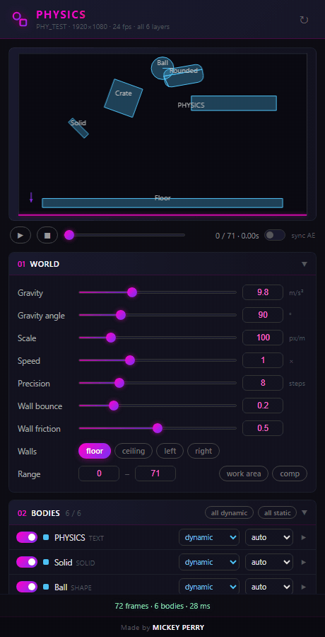

# Physics for After Effects

Newton-style 2D rigid-body physics as a dockable After Effects panel. Pick layers, set body types, tweak the world with
sliders while a live preview plays, then **Bake** writes real Position + Rotation keyframes onto your layers.

Built on [planck.js](https://github.com/piqnt/planck.js) — a JavaScript port of **Box2D**, the same engine Newton uses —
so stacking, bouncing, friction and sleeping behave the way you expect.

Free & open source · Windows · After Effects 2020+ · [Project page](https://mickeyperry.github.io/AESCRIPTS/Physics/)

## Install

1. [Download the ZIP](https://github.com/mickeyperry/ae-physics/archive/refs/heads/main.zip) and extract it anywhere.
2. Double-click **`install.bat`**. It enables unsigned CEP panels for your user and copies the panel into
   `%APPDATA%\Adobe\CEP\extensions\com.mickyp.physics`.
3. Restart After Effects and open **Window > Extensions > Physics**.

`uninstall.bat` removes it again. Developers: `deploy.ps1` mirrors the working copy into the extensions folder.

## Using it

1. Open a comp. Select the layers you want simulated (nothing selected = all layers) and hit the **⟳ refresh** button.
2. **Bodies** — per layer:
   - **type** — `dynamic` falls and collides · `static` is immovable (floors, walls) · `kinematic` follows its own AE
     keyframes and pushes things · `dormant` sleeps until something hits it.
   - **shape** — `auto` reads shape-layer primitives / masks / the bounding box · `box` · `circle` · `hull`.
   - Click a row for density, friction, bounce, drag, spin, initial velocity, lock rotation, bullet (continuous collision)
     and collides. **copy to all** pushes one body's settings to every included body.
3. **World** — gravity and its angle (90° = down), scale (px per meter), speed, precision (substeps), wall bounce and
   friction, which comp edges act as walls, and the frame range.
4. Scrub or play the preview (Space toggles playback; **sync AE** moves the AE playhead while you scrub).
5. **Bake to keyframes**. Options: unparent, clear existing keys in range, linear keys, rotation, key every N frames.
   Undo is a single step.

Every numeric parameter is a **slider + number box**: drag the slider for the useful range, type in the box for
anything beyond it (the box turns amber when the value is outside the slider range). **Double-click a label** to
reset it, **mouse-wheel** over a slider to nudge one step (Shift = 10 steps). Cards collapse by clicking their header.
Settings are remembered per composition.

Bodies are read at the range start frame. Layer scale is baked into the collision shape; rotation becomes the body
angle. Parented layers are un-parented on bake (keeping their visual transform). Position/Rotation expressions are
disabled on bake.

## Layout

- `host/physics.jsx` — ExtendScript: reads layers (transform, shape primitives, masks), samples kinematic layers, bakes keyframes.
- `client/geometry.js` — affine transforms, bezier sampling, convex hull, rounded rects, polystars.
- `client/sim.js` — scene → planck world → per-frame transforms. Also runs in Node.
- `client/main.js`, `index.html`, `style.css` — the panel.
- `test/run_node_test.js` — run a saved scene JSON through the simulator headlessly.

## Roadmap

Joints (pin / distance / spring / wheel), magnetism, concave decomposition for paths, per-character text bodies,
alpha-based shapes for footage, collision groups.

## License

MIT — see [LICENSE](LICENSE). Bundles planck.js (MIT).
